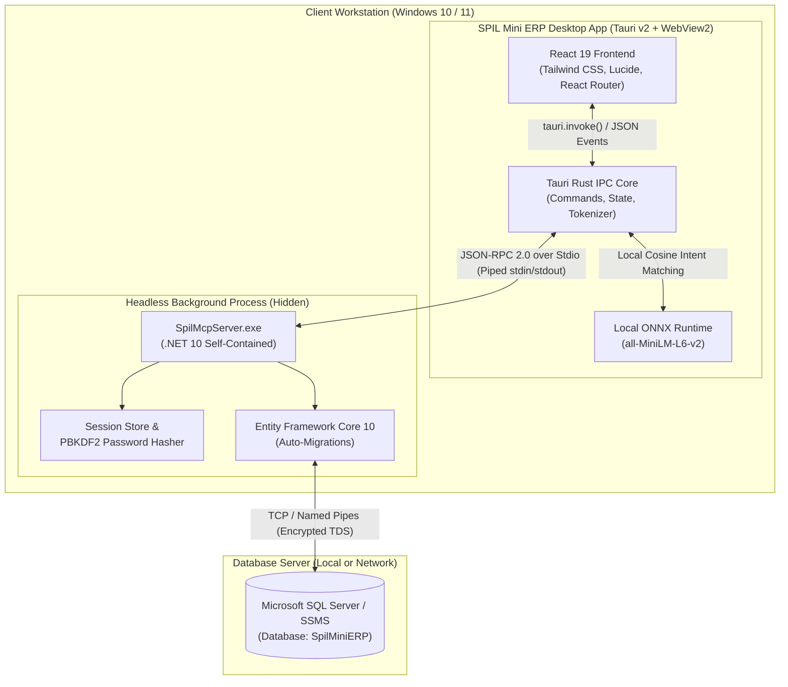
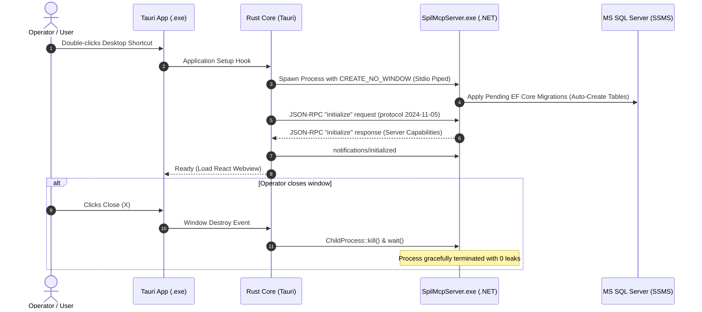
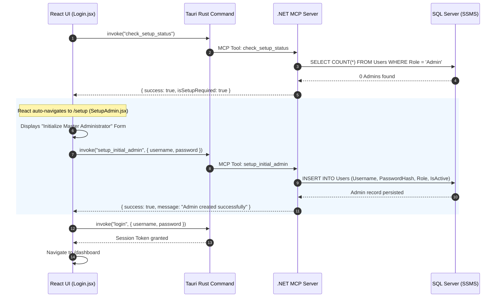
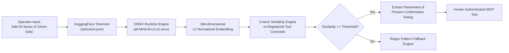

# SPIL Mini ERP

> **Modern, Local-First Desktop Enterprise Resource Planning (ERP) System**  
> Powered by **React 19**, **Tauri 2 (Rust)**, **.NET 10 (C#) Model Context Protocol (MCP) Server**, and **Local ONNX Semantic AI**.

---

## 📑 Table of Contents

1. [Executive Summary](#-executive-summary)
2. [High-Level Architecture](#-high-level-architecture)
3. [Low-Level Architecture & Process Lifecycle](#-low-level-architecture--process-lifecycle)
4. [First-Run Setup & SQL Server Auto-Migration](#-first-run-setup--sql-server-auto-migration)
5. [Local ONNX Semantic Intent Engine](#-local-onnx-semantic-intent-engine)
6. [Complete MCP Tools Reference](#-complete-mcp-tools-reference)
   - [RBAC Authorization Matrix](#rbac-authorization-matrix)
   - [Authentication & Setup Tools](#1-authentication--setup-tools)
   - [Inventory Management Tools](#2-inventory-management-tools)
   - [Order Processing Tools](#3-order-processing-tools)
   - [User Administration Tools](#4-user-administration-tools)
7. [Source-to-Executable Packaging Guide](#-source-to-executable-packaging-guide)
8. [Database & SSMS Configuration](#-database--ssms-configuration)
9. [Development Workflow](#-development-workflow)

---

## 🚀 Executive Summary

**SPIL Mini ERP** is a robust, privacy-respecting desktop ERP application designed for small-to-medium enterprises. It unifies inventory control, atomic multi-item order fulfillment, and role-based operator administration into a single, high-performance desktop executable.

### Core Highlights:
- **Zero-Flicker Desktop Shell:** Built on Tauri 2.0 with a React 19 UI, consuming ~40MB RAM.
- **Headless .NET MCP Micro-Daemon:** High-throughput business logic running in the background with hidden console flags (`CREATE_NO_WINDOW`).
- **Standardized AI Integration:** All ERP capabilities are exposed through the open **Model Context Protocol (MCP)** over JSON-RPC stdio pipes.
- **Built-in Local Semantic Engine:** Processes natural-language operational prompts locally using an ONNX runtime embedding model (`all-MiniLM-L6-v2`) with zero external cloud dependencies.
- **Enterprise Database Backend:** Managed via Entity Framework Core with automatic SQL Server / SSMS migrations.

---

## 🏛 High-Level Architecture

The system operates on a multi-tier, local-first architecture:



---

## 🔍 Low-Level Architecture & Process Lifecycle

### 1. Process Lifecycle & IPC Mechanics

When an operator launches `SPIL Mini ERP.exe`:
1. **Bootstrap:** Tauri initializes WebView2 and starts `SpilMcpServer.exe` as a child process using the Windows `CREATE_NO_WINDOW` creation flag (`0x08000000`).
2. **Handshake:** Rust sends an MCP `initialize` JSON-RPC handshake over standard input (`stdin`) and waits for protocol capability confirmation.
3. **Session State:** Rust maintains session tokens in an in-memory `Mutex<Option<UserSession>>`. All privileged MCP requests automatically inject the operator's active token.
4. **Shutdown Guarantee:** The Rust runtime implements `Drop` for `McpClient`. Terminating the desktop window immediately signals and kills the .NET background daemon, preventing orphaned processes.



---

## ⚡ First-Run Setup & SQL Server Auto-Migration

To ensure smooth evaluation on supervisor or client machines, manual SQL execution is never required:



---

## 🧠 Local ONNX Semantic Intent Engine

The desktop app features an AI command interface allowing operators to manage inventory and orders using plain conversational English.



---

## 🛠 Complete MCP Tools Reference

All business logic operations are executed through the Model Context Protocol.

### RBAC Authorization Matrix

| Tool Name | Scope | Admin | Store Keeper (`Store`) | Sales Rep (`Sales`) | Public |
| :--- | :--- | :---: | :---: | :---: | :---: |
| `check_setup_status` | System Setup | ✅ | ✅ | ✅ | ✅ |
| `setup_initial_admin` | System Setup | ✅ *(First run only)* | ❌ | ❌ | ✅ *(0 Admins only)* |
| `login` | Authentication | ✅ | ✅ | ✅ | ✅ |
| `get_current_user` | Authentication | ✅ | ✅ | ✅ | ❌ |
| `get_inventory` | Inventory | ✅ | ✅ | ✅ | ❌ |
| `create_inventory` | Inventory | ✅ | ✅ | ❌ | ❌ |
| `update_inventory` | Inventory | ✅ | ✅ | ❌ | ❌ |
| `deactivate_inventory` | Inventory | ✅ | ✅ | ❌ | ❌ |
| `get_orders` | Orders | ✅ *(All Orders)* | ❌ | ✅ *(Own Orders Only)* | ❌ |
| `create_order` | Orders | ✅ | ❌ | ✅ | ❌ |
| `get_users` | Administration | ✅ | ❌ | ❌ | ❌ |
| `create_user` | Administration | ✅ | ❌ | ❌ | ❌ |

---

### 1. Authentication & Setup Tools

#### `check_setup_status`
Checks if the system requires first-run administrator provisioning.
- **Role:** None (Public)
- **Input Parameters:** None
- **Response:**
  ```json
  {
    "success": true,
    "isSetupRequired": true
  }
  ```

#### `setup_initial_admin`
Provisions the initial Admin user account. Permanently disabled once an Admin exists.
- **Role:** None (Locked when `>= 1` Admin exists in database)
- **Arguments:**
  | Name | Type | Required | Constraints |
  | :--- | :--- | :--- | :--- |
  | `username` | `string` | Yes | 1–100 characters. |
  | `password` | `string` | Yes | Minimum 8 characters. Salted & hashed with PBKDF2. |

#### `login`
Authenticates credentials and establishes a 2-hour sliding secure session.
- **Role:** None (Public)
- **Arguments:**
  | Name | Type | Required | Description |
  | :--- | :--- | :--- | :--- |
  | `username` | `string` | Yes | Target operator username. |
  | `password` | `string` | Yes | Account password. |
- **Response:**
  ```json
  {
    "success": true,
    "sessionToken": "4e72391f-0b2a-4db3-90d2-97fc8347e301",
    "username": "admin",
    "role": "Admin",
    "expiresInSeconds": 7200
  }
  ```

#### `get_current_user`
Validates active session token and returns operator details.
- **Role:** Authenticated (`Admin`, `Store`, `Sales`)
- **Arguments:** `sessionToken` (`string`, required)

---

### 2. Inventory Management Tools

#### `get_inventory`
Retrieves products from the catalog.
- **Role:** `Admin`, `Store`, `Sales`
- **Arguments:**
  | Name | Type | Required | Default | Description |
  | :--- | :--- | :--- | :--- | :--- |
  | `sessionToken` | `string` | Yes | - | Active session token. |
  | `includeInactive` | `boolean` | No | `false` | When true, includes archived items (Admin/Store only). |

#### `create_inventory`
Registers a new product in the ERP catalog.
- **Role:** `Admin`, `Store`
- **Arguments:**
  | Name | Type | Required | Description |
  | :--- | :--- | :--- | :--- |
  | `sessionToken` | `string` | Yes | Authorized session. |
  | `sku` | `string` | Yes | Unique SKU identifier (max 50 chars). |
  | `name` | `string` | Yes | Product display title (max 150 chars). |
  | `quantityAvailable` | `integer`| Yes | Initial stock balance (`>= 0`). |
  | `unitPrice` | `decimal`| Yes | Selling price per unit (`>= 0.00`). |
  | `description` | `string` | No | Optional product notes (max 2000 chars). |

#### `update_inventory`
Updates product specifications, pricing, stock levels, or status.
- **Role:** `Admin`, `Store`
- **Arguments:** `sessionToken`, `inventoryId`, `sku`, `name`, `quantityAvailable`, `unitPrice`, `isActive`, `description`

#### `deactivate_inventory`
Soft-deletes a product without breaking existing historical order records.
- **Role:** `Admin`, `Store`
- **Arguments:** `sessionToken`, `inventoryId`

---

### 3. Order Processing Tools

#### `get_orders`
Fetches order records and item breakdowns.
- **Role:** `Admin` (retrieves all company orders), `Sales` (retrieves orders placed by the current user)
- **Arguments:** `sessionToken` (`string`, required)

#### `create_order`
Performs an **atomic database transaction** verifying stock, calculating totals, creating order headers/items, and decrementing inventory.
- **Role:** `Admin`, `Sales`
- **Arguments:**
  | Name | Type | Required | Description |
  | :--- | :--- | :--- | :--- |
  | `sessionToken` | `string` | Yes | Active session. |
  | `itemsJson` | `string` | Yes | Serialized JSON array of item orders. |
- **`itemsJson` Format:**
  ```json
  [
    { "inventoryId": 1, "quantity": 25 },
    { "inventoryId": 4, "quantity": 10 }
  ]
  ```
- **Concurrency & Integrity:** If any requested quantity exceeds live inventory, the transaction rolls back with a detailed insufficient stock payload.

---

### 4. User Administration Tools

#### `get_users`
Lists all operator accounts in the ERP system.
- **Role:** `Admin` only
- **Arguments:** `sessionToken` (`string`, required)

#### `create_user`
Provisions an operational account for a staff member.
- **Role:** `Admin` only
- **Arguments:**
  | Name | Type | Required | Values / Constraints |
  | :--- | :--- | :--- | :--- |
  | `sessionToken` | `string` | Yes | Admin session. |
  | `username` | `string` | Yes | Unique name (1–100 chars). |
  | `password` | `string` | Yes | Minimum 8 characters. |
  | `role` | `string` | Yes | `"Store"` or `"Sales"`. |

---

## 📦 Source-to-Executable Packaging Guide

Follow these exact steps to compile the entire project into a single distribution installer:

### Prerequisites:
1. **Windows 10 / 11 (64-bit)**
2. **.NET SDK 10.0** (or 9.0+)
3. **Node.js 20+** & **npm**
4. **Rust & Cargo** (installed via [rustup.rs](https://rustup.rs/))
5. **Visual Studio C++ Build Tools** (MSVC compiler)

---

### The One-Command Automated Build

Run the automated orchestrator from the `frontend` folder:

```powershell
cd E:\spil\spil-mini-erp\frontend
npm run build:app
```

### What This Command Executes Under the Hood:

1. **Compiles .NET MCP Server as Single-File Self-Contained:**
   ```powershell
   dotnet publish ../backend/SpilMcpServer/SpilMcpServer/SpilMcpServer.csproj `
     -c Release `
     -r win-x64 `
     --self-contained true `
     -p:PublishSingleFile=true `
     -p:IncludeNativeLibrariesForSelfExtract=true `
     -o src-tauri/bin
   ```
2. **Builds Optimized Frontend Bundle:**
   ```powershell
   npm run build
   ```
3. **Builds Native Tauri Installer:**
   ```powershell
   npm run tauri build
   ```

### 🎯 Output Artifacts

Upon completion, your distributables are located at:
```text
frontend/src-tauri/target/release/bundle/nsis/
└── SPIL Mini ERP_0.1.0_x64-setup.exe   <--- Windows Standard Installer
```

---

## 🗄 Database & SSMS Configuration

### Default Connection String
Located in `appsettings.json` (inside `backend/SpilMcpServer/SpilMcpServer/appsettings.json` and bundled in `bin/`):

```json
{
  "ConnectionStrings": {
    "DefaultConnection": "Server=.\\MSSQLSERVER01;Database=SpilMiniERP;Trusted_Connection=True;TrustServerCertificate=True;"
  }
}
```

### Configuring for Different Environments:

* **Local Machine with SQL Express:**
  Change server to: `Server=.\\SQLEXPRESS;Database=SpilMiniERP;...`
* **Local Machine with Default Instance:**
  Change server to: `Server=localhost;Database=SpilMiniERP;...`
* **Central Office / LAN Server:**
  Change server to: `Server=192.168.1.100;Database=SpilMiniERP;User Id=erp_user;Password=YourPassword;...`

> [!NOTE]
> When the application starts for the first time, EF Core will automatically connect to your SQL Server and create the `SpilMiniERP` database and all required tables. You can open **SQL Server Management Studio (SSMS)** to inspect and query the data directly.

---

## 💻 Development Workflow

If you want to run the project in development mode:

1. **Start the Frontend & Tauri:**
   ```powershell
   cd frontend
   npm run tauri dev
   ```
2. The Tauri dev server will launch Vite on `http://localhost:1420` and automatically connect to your development `.NET` backend.
