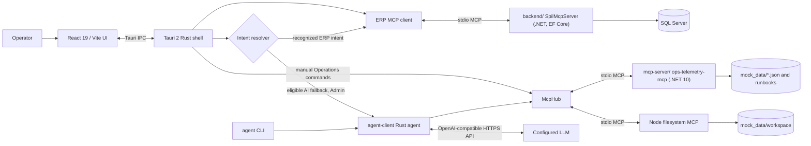

# SPIL Mini ERP — Incident Triage & Release Readiness Agent

SPIL Mini ERP is a Windows desktop ERP application with an incident and release operations workspace. It combines a React/Tauri interface, a SQL Server backed ERP MCP server, a separate mock telemetry MCP server, and a Rust AI agent. The agent can investigate service incidents and release readiness using MCP tools. A person must approve ticket creation requested by the agent.

This repository is an assignment and local development environment. The operations data is fixture data in `mock_data/`; it is not live production telemetry.

## Contents

- [What is available](#what-is-available)
- [Architecture](#architecture)
- [Requirements](#requirements)
- [Run the desktop app](#run-the-desktop-app)
- [Use the incident workspace](#use-the-incident-workspace)
- [Run the standalone agent](#run-the-standalone-agent)
- [Connect Claude Desktop to local MCP](#connect-claude-desktop-to-local-mcp)
- [Connect ChatGPT to MCP](#connect-chatgpt-to-mcp)
- [Configuration and data](#configuration-and-data)
- [Security and approvals](#security-and-approvals)
- [Tests and evaluation](#tests-and-evaluation)
- [Build and distribution](#build-and-distribution)
- [Troubleshooting](#troubleshooting)

## What is available

| Area | Current behavior |
| --- | --- |
| ERP | Dashboard, inventory, orders, and users use the SQL Server backed ERP MCP server. Access depends on the signed-in role. |
| Operations | Admins can inspect the three mock services, health, logs, deployment history, release checklist, runbooks, and incident tickets. |
| Manual tickets | The **Create incident ticket** button opens a form. Review the details and confirm to save; tickets appear under **Tickets**, with a service filter and refresh. |
| AI assistant | Recognized ERP requests use a deterministic intent resolver. Incident investigations and other eligible requests can fall back to the Rust agent. |
| AI ticket approvals | When the agent proposes `create_incident_ticket`, an Admin approves or rejects the request in the **chat approval card**. The request expires after 120 seconds. There is no separate Operations approval queue. |
| CLI agent | The same Rust agent can run from a terminal with an interactive approval prompt, explicit approve/reject flags, a demo query, or an eight-case evaluation suite. |

The telemetry server currently supports **creating and listing** incident tickets. It has no update, reassignment, comment, or resolve ticket tool. Release readiness is an evidence review, not a deployment control. The “responsible team” shown on a ticket is its stored assignee label, not a live paging integration.

## Architecture



There are **two different C# MCP servers**:

1. `backend/SpilMcpServer/SpilMcpServer/` is the ERP server. Tauri starts it using `frontend/src-tauri/src/mcp/client.rs`. It uses EF Core with SQL Server for authentication, inventory, orders, and users.
2. `mcp-server/` is the operations telemetry server. The Rust `McpHub` launches it and the Node filesystem MCP server. Its tools use local fixture files and do not query SQL Server.

The desktop Operations page calls `operations_overview`, `operations_service_detail`, `operations_list_tickets`, and `operations_create_ticket` in Tauri. These call telemetry MCP tools or resources through `McpHub`. The page can load telemetry without an LLM key; AI chat needs a configured LLM key. Both Operations and AI chat require an Admin session.

The AI path is `frontend/src-tauri/src/commands/intent.rs` → `agent-client/src/agent.rs` → `agent-client/src/mcp/hub.rs`. The hub starts local MCP processes, discovers their tools and resources, and routes calls by server. The agent sends tool definitions to an OpenAI-compatible chat completions API and iterates until it has an answer or reaches `MAX_ITERATIONS`. It exposes telemetry resources through a synthetic `read_resource` tool. The CLI in `agent-client/src/main.rs` uses the same library. The actual implementation uses Tokio, `rmcp`, and `reqwest`.

### Operations MCP catalog

| Telemetry tool | Purpose | Writes data? |
| --- | --- | --- |
| `list_services` | List monitored services | No |
| `get_service_health` | Health and status of one service | No |
| `search_logs` | Filter mock service logs | No |
| `get_deployment_history` | Recent deployment records | No |
| `list_incident_tickets` | Read incident tickets | No |
| `create_incident_ticket` | Append a new ticket to `mock_data/tickets.json` | Yes |

Resources: `config://release-checklist`, three fixed `service://runbooks/<service>` resources, and the `service://runbooks/{service_name}` template. The filesystem MCP server is limited to `mock_data/workspace/` by its launch argument; the Rust policy applies additional filtering when the **Rust agent** uses it.

### Repository map

| Path | Role |
| --- | --- |
| `frontend/src/` | React pages, components, styles, and Tauri service calls |
| `frontend/src-tauri/` | Desktop shell, ERP MCP client, intent router, Operations commands, and chat approval events |
| `backend/` | ERP stdio MCP server and SQL Server data model |
| `mcp-server/` | Operations telemetry stdio MCP server and resources |
| `agent-client/` | Rust agent library, CLI, policies, evaluation, tests, and traces |
| `mock_data/` | Mock telemetry, ticket store, runbooks, and release workspace |
| `docs/` | Assignment material and supporting documentation |

## Requirements

On Windows, install:

- .NET 10 SDK (`dotnet --version`)
- Rust toolchain and Cargo (`cargo --version`)
- Node.js and npm, with `npx` available (`node --version`, `npx --version`)
- Visual Studio C++ build tools and WebView2 for Tauri development
- A reachable SQL Server instance and a valid ERP connection string
- An API key for an OpenAI-compatible chat endpoint **only if using the AI agent**

Use PowerShell from the repository root for the commands below. The Rust hub starts the filesystem server through a global npm installation if found, otherwise through `cmd /C npx -y @modelcontextprotocol/server-filesystem`. The first `npx` launch may need network access.

## Run the desktop app

1. Configure the ERP SQL Server connection string in the backend's `appsettings.json` or its supported configuration source. Check `backend/SpilMcpServer/SpilMcpServer/appsettings.json` for the `ConnectionStrings:DefaultConnection` key. The backend applies EF Core migrations at startup.
2. Build both MCP servers and install frontend packages:

   ```powershell
   dotnet build backend/SpilMcpServer/SpilMcpServer/SpilMcpServer.csproj
   dotnet build mcp-server/ops-telemetry-mcp.csproj
   npm --prefix frontend install
   ```

3. For AI chat, create the root `.env` file and set a real key. Keep the file uncommitted:

   ```powershell
   Copy-Item .env.example .env
   ```

   At minimum, set `LLM_API_KEY`. Adjust `LLM_BASE_URL` and `LLM_MODEL` for your provider. The default example is an OpenAI-compatible endpoint; it does not connect the ChatGPT desktop app to MCP.

4. Start Tauri:

   ```powershell
   npm --prefix frontend run tauri dev
   ```

Log in with a valid account in your SQL Server database. The admin login used in local QA was `admin` / `12345678`; it works only if that account exists in **your** database. For an empty installation, use the app's initial Admin setup flow. Do not treat the QA password as a production credential.

The desktop shell starts the ERP MCP server automatically. The telemetry and filesystem MCP processes start when the Operations page or AI agent first needs them. Do not open the stdio server executables as standalone interactive windows; an MCP host must communicate with them over stdin/stdout.

## Use the incident workspace

1. Sign in as Admin and open **Incidents & Release**.
2. Select `auth-service`, `order-service`, or `inventory-service` to see the selected service's **Triage** and **Release** evidence.
3. Open **Tickets** to view all tickets, filter by service, or refresh. The ticket list also refreshes while its tab is open.
4. Select **Create incident ticket**, enter service, severity, title, technical summary, and responsible team. Review the draft and select **Confirm creation**. A success notice closes automatically after five seconds and can be dismissed.
5. For AI investigation, open **AI Assistant** and ask a specific question such as “Why is order-service failing?” If the agent proposes a ticket, review the request in the chat card and approve or reject it there. Approval is required before the tool writes the ticket.

Ticket records are stored in `mock_data/tickets.json`. The mock service names and team IDs are fixed by the telemetry fixture and manual form validation. Ticket IDs such as `INC-1045` are data, not transient alerts; they remain in the Tickets view until the fixture file is changed. No ticket detail or status editing screen exists yet.

## Run the standalone agent

Build the telemetry server first, then create the root `.env` with `LLM_API_KEY`. From the repo root:

```powershell
cargo run --manifest-path agent-client/Cargo.toml -- --query "Why is order-service failing?"
cargo run --manifest-path agent-client/Cargo.toml -- --query "Investigate order-service and open a ticket if needed"
cargo run --manifest-path agent-client/Cargo.toml -- --demo
```

With no query, the CLI enters an interactive prompt. It asks `[y/N]` before a mutating tool call. `--approve` and `--reject` replace that human prompt with a fixed decision; use them only for controlled scripts or evaluation. `--json` prints the agent result in JSON form, though startup information is also printed. See `--help` for all flags.

The CLI and Tauri agent require the exact debug telemetry binary at `mcp-server/bin/Debug/net10.0/ops-telemetry-mcp.exe`. They set `MOCK_DATA_DIR` for the child process. Agent traces are written to `agent-client/traces/agent_traces.jsonl`.

## Connect Claude Desktop to local MCP

Claude Desktop can launch this repository's **telemetry MCP server directly**. This gives Claude the six telemetry tools and its resources. It does **not** run the Rust agent, the ERP UI, the Tauri Admin check, or the app's chat approval card. See the [Claude local MCP guide](https://support.claude.com/en/articles/10949351-getting-started-with-local-mcp-servers-on-claude-desktop) and the [MCP host configuration guide](https://py.sdk.modelcontextprotocol.io/get-started/real-host/).

1. Build the telemetry binary:

   ```powershell
   dotnet build mcp-server/ops-telemetry-mcp.csproj
   ```

2. Open Claude Desktop once. On Windows, edit `%APPDATA%\Claude\claude_desktop_config.json`. Add this entry to its existing `mcpServers` object, preserving other entries:

   ```json
   {
     "mcpServers": {
       "spil-ops-telemetry": {
         "command": "E:\\spil\\spil-mini-erp\\mcp-server\\bin\\Debug\\net10.0\\ops-telemetry-mcp.exe",
         "args": [],
         "env": {
           "MOCK_DATA_DIR": "E:\\spil\\spil-mini-erp\\mock_data"
         }
       }
     }
   }
   ```

   Change both paths if the checkout is elsewhere. JSON needs doubled backslashes in Windows paths. Alternatively, use forward slashes in the path strings. `MOCK_DATA_DIR` points to the **directory**, not a JSON file.

3. Fully quit and reopen Claude Desktop. Check its local MCP tools for `list_services` or `search_logs`; ask it to list the monitored services. If the server does not appear, check the JSON syntax, executable path, and Claude's MCP logs.

You may separately configure `@modelcontextprotocol/server-filesystem` for `mock_data/workspace/`, but that directory includes a **fake `.env` decoy**. Direct host access bypasses the Rust agent's secret-path policy. Only expose a directory you intend that host to read; copy the release files into a separate safe folder if needed. Direct Claude tool calls to `create_incident_ticket` also bypass this app's Admin and chat approval gate.

## Connect ChatGPT to MCP

There is no `claude_desktop_config.json` equivalent that lets ordinary ChatGPT Desktop users paste this local stdio executable into a standard MCP connector. [OpenAI's ChatGPT developer-mode documentation](https://help.openai.com/en/articles/12584461-developer-mode-and-full-mcp-connectors-in-chatgpt-beta) says standard ChatGPT MCP connections use **remote MCP servers**; private/local servers need a supported [Secure MCP Tunnel](https://developers.openai.com/api/docs/guides/secure-mcp-tunnels) or an accessible remote MCP endpoint. This repository currently provides **stdio only**, with no HTTP adapter, tunnel configuration, or deployed endpoint.

There is also a [desktop-only local MCP plugin route](https://developers.openai.com/plugins/deploy/desktop-only) for **approved, allowlisted partners**. It requires a packaged plugin with `mcp.json`, bundled server/dependencies, testing, and submission. This repository is not such a plugin. Availability and plan permissions are controlled by OpenAI and may change.

If your ChatGPT workspace and OpenAI Platform organization have access to Secure MCP Tunnel, the [official tunnel guide](https://developers.openai.com/api/docs/guides/secure-mcp-tunnels) describes the local-development path:

1. Build the telemetry EXE and confirm that `MOCK_DATA_DIR` points at this checkout's `mock_data/` folder.
2. Create a tunnel in OpenAI Platform settings and obtain a tunnel ID and a restricted runtime key. Install `tunnel-client` on the Windows machine; configure its MCP target as this telemetry **stdio command** with `MOCK_DATA_DIR` in the child environment.
3. Run the tunnel client's validation command and keep it running. In ChatGPT on the web, use **Plugins → + → Add custom MCP server → Tunnel**, select the tunnel, and inspect the discovered tools. Workspace and Platform tunnel permissions are separate.
4. Make a read-only `list_services` call first. Before exposing `create_incident_ticket`, account for the fact that this direct connection does not use the desktop app's Admin check or approval card.

The alternative is to implement and host an authenticated **Streamable HTTP** MCP endpoint, then register its URL in the [custom MCP server flow](https://developers.openai.com/api/docs/guides/custom-mcp-server). Neither route is configured in this repository. Connecting the Tauri app to an OpenAI-compatible API through `LLM_API_KEY` is a separate, already implemented direction: the **app calls the model**, rather than ChatGPT Desktop directly calling the local MCP server.

## Configuration and data

| Setting | Default in code/example | Effect |
| --- | --- | --- |
| `LLM_BASE_URL` | `https://api.openai.com/v1` | OpenAI-compatible API base URL |
| `LLM_API_KEY` | Unset / placeholder | Required for CLI and AI chat; never needed by telemetry MCP itself |
| `LLM_MODEL` | `gpt-5.4-mini` | Chat model identifier; set to one available from your provider |
| `EMBEDDING_MODEL` | Provider-dependent default | Optional model setting |
| `MAX_ITERATIONS` | `8` | Agent loop limit |
| `TOOL_TIMEOUT_SECONDS` | `15` | Agent tool-call timeout |
| `OPS_SLOW_MS` | `0` | Optional telemetry delay for testing |
| `MOCK_DATA_DIR` | Set by the Rust hub | Telemetry fixture root when launched externally |

The root `.env` is loaded by `AgentConfig`; process environment variables take precedence when already set. The desktop LLM Settings screen can persist provider, base URL, model, and embedding model to the app config directory's `llm_settings.json`. It **does not store API keys**; set `LLM_API_KEY` in the environment or root `.env`. The C# MCP servers do not receive the LLM key from the Rust agent.

`mock_data/` contains service health, logs, deployment history, runbooks, the release checklist, and mutable `tickets.json`. `mock_data/workspace/` is the filesystem MCP root and contains release documents and a fake secret file used for guardrail testing. The mock timestamps are fixed fixture timestamps, not current monitoring data.

## Security and approvals

- ERP calls use the signed-in session and role checks. Inventory changes are available to Admin/Store, order actions to Admin/Sales, and user management to Admin. Operations and AI fallback require Admin.
- The Rust agent hides selected mutating filesystem tools from the model, checks filesystem paths for traversal and protected names, treats MCP output as untrusted data, flags suspicious prompt injection patterns, caps tool output, and limits tool duration and iteration count.
- Read-only MCP tools can execute without a prompt. `create_incident_ticket` requires an `Approver`: a CLI prompt or a desktop chat card. A rejection is recorded and the agent continues without performing the write. Desktop requests time out after 120 seconds.
- These are **client-side agent protections**. Connecting another MCP host directly to `ops-telemetry-mcp.exe` bypasses the Rust policy, Tauri role check, and this app's approval workflow. The telemetry server's write tool itself does not authenticate a user.
- Keep real keys out of Git, logs, mock fixtures, and MCP arguments. The workspace `.env` is only a fake decoy.

## Tests and evaluation

Run the relevant checks from the repo root:

```powershell
cargo test --manifest-path agent-client/Cargo.toml
cargo test --manifest-path frontend/src-tauri/Cargo.toml
npm --prefix frontend run build
dotnet build mcp-server/ops-telemetry-mcp.csproj
```

The agent's `--eval` mode runs eight prompts covering log lookup, root cause, release readiness, invalid and ambiguous requests, prompt injection, approved ticket creation, and rejected ticket creation. It calls the configured LLM, so results, latency, and cost depend on the provider. It writes evaluation traces under `agent-client/traces/` and a summary to `agent-client/eval_results.md`.

**Important:** `--eval` resets `mock_data/tickets.json` to its one-ticket seed before every case and after the suite. Back up tickets you want to keep before running it. A regular `cargo test` is separate; check individual integration tests before running any that may mutate fixtures. There is no fixed “100% pass” guarantee in this README.

## Build and distribution

`npm --prefix frontend run tauri build` builds the Tauri bundle; `npm --prefix frontend run build:app` also publishes the ERP backend into `frontend/src-tauri/bin/` first. The Tauri bundle configuration currently includes `bin/*` resources, but it does **not** bundle the telemetry debug executable, `mock_data/`, or the Node filesystem MCP package. The operations and AI features therefore require this repo checkout and development dependencies unless packaging is extended. Treat the installer as a development artifact, not a self-contained release of the complete AI Ops system.

## Troubleshooting

| Symptom | Check |
| --- | --- |
| Login fails or ERP pages are empty | Verify SQL Server is reachable, the connection string is correct, backend migration succeeded, and the account exists. |
| Tauri cannot locate ERP MCP | Build `backend/SpilMcpServer/SpilMcpServer/SpilMcpServer.csproj`; the dev client uses `dotnet run --no-build` when it cannot find a bundled executable. |
| Operations page cannot load | Build `mcp-server/ops-telemetry-mcp.csproj`; confirm the debug EXE and `mock_data/` exist, and `node`/`npx` are on PATH. |
| AI chat reports missing key | Set `LLM_API_KEY` in root `.env` or process environment, then restart the app. |
| Claude Desktop does not show tools | Fully restart it; check config JSON, absolute EXE path, `MOCK_DATA_DIR`, and local MCP logs. |
| ChatGPT does not accept the local EXE path | The standard connector needs a supported remote endpoint or tunnel; this repo has only stdio. |
| Ticket cannot be updated or resolved | These tools and UI actions are not implemented in the telemetry server. |

For the original assignment and server-specific details, see `docs/Intern Assignment 2.pdf` and `docs/MCP_TOOLS.md`. The assignment PDF is image-only; this README describes the checked-in implementation rather than claiming to reproduce every appendix verbatim.
